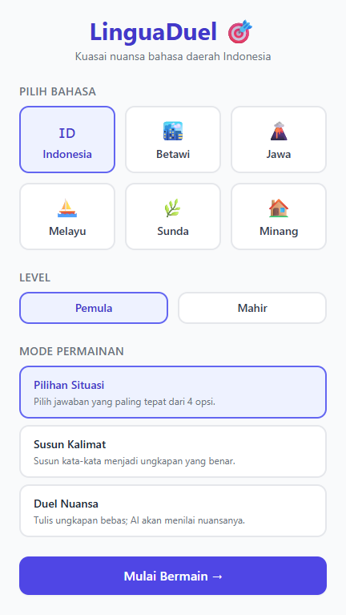
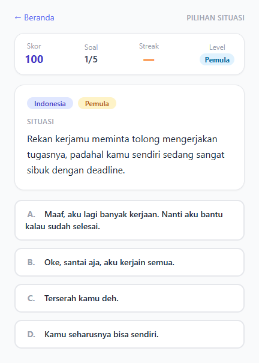
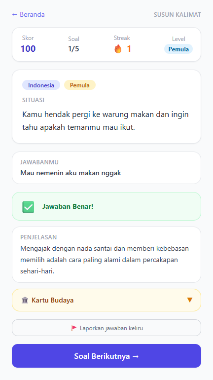
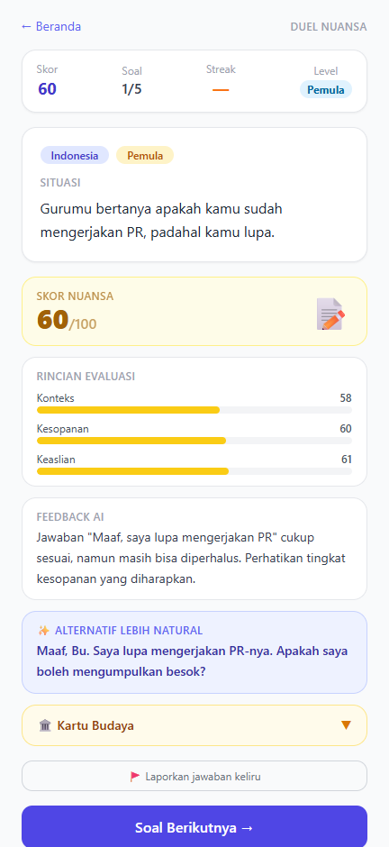
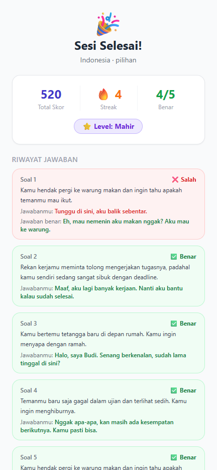

# LinguaDuel: AI Idiom Battle

Game bahasa interaktif untuk belajar **nuansa** bahasa daerah. AI membuat situasi sehari-hari, lalu pemain memilih, menyusun, atau menulis ungkapan yang paling tepat. Setelah menjawab, pemain mendapat penjelasan konteks dan "Kartu Budaya" tentang ungkapan tersebut.

> Dibuat dengan **IBM Bob** untuk proposal hackathon. Seluruh proses (prompt, hasil, koreksi, bukti) tercatat di [`BOB_LOG.md`](BOB_LOG.md).

## Masalah yang diselesaikan
Banyak anak muda tahu arti kata dalam bahasa daerah, tetapi tidak tahu **kapan, kepada siapa, dan dalam suasana apa** kata itu pantas dipakai. Aplikasi belajar bahasa umumnya berhenti di kosakata. LinguaDuel melatih pemakaian kontekstual lewat situasi nyata dan umpan balik instan.

## Bahasa
Indonesia, Betawi, Jawa, Melayu, Sunda, Minang.

## Mode permainan
| Mode | Cara main |
|---|---|
| **Pilihan Situasi** | AI memberi situasi, pemain memilih 1 dari 4 ungkapan |
| **Duel Nuansa** | Pemain menulis jawaban bebas, AI menilai skor 0-100 (konteks, kesopanan, keaslian) |
| **Susun Kalimat** | Pemain menyeret kata (drag-and-drop) menjadi kalimat yang tepat |

## Cara bermain
1. Buka `http://localhost:5173`.
2. Pilih **bahasa**, **level** (Pemula/Mahir), dan **mode** permainan, lalu tekan **Mulai Bermain**.
3. Satu sesi berisi **5 soal**. Cara menjawab tergantung mode:
   - **Pilihan Situasi:** baca situasi, ketuk 1 dari 4 ungkapan.
   - **Susun Kalimat:** ketuk kata di "Bank Kata" untuk memindahkannya ke Area Jawaban, atau seret kata untuk mengubah urutan. Ketuk kata di Area Jawaban untuk mengembalikannya (keyboard: Enter/Spasi). Tekan **Periksa** bila sudah selesai.
   - **Duel Nuansa:** tulis ungkapan bebasmu untuk situasi tersebut, lalu kirim. AI memberi skor 0-100 beserta rincian konteks, kesopanan, keaslian, dan alternatif yang lebih natural.
4. Setelah menjawab, baca **penjelasan** dan **Kartu Budaya**. Bila jawaban kunci terasa keliru, tekan **Laporkan jawaban keliru**.
5. Skor: jawaban benar 100 poin, ditambah bonus streak 20% per jawaban benar beruntun (maksimal 60%). Di Duel Nuansa, poin = skor AI dengan bonus streak yang hanya berlaku bila skor 70 ke atas.
6. Di halaman **Result** terlihat total skor, streak, peringkat (500 poin ke atas = Mahir), dan riwayat tiap soal. Tekan **Main lagi** untuk sesi baru.

Fitur pendukung: skor, streak, level (Pemula/Mahir), riwayat jawaban per soal di halaman Result, Kartu Budaya, dan tombol "Laporkan jawaban keliru".

## Tampilan
<table>
<tr>
<td align="center" valign="top"><br><b>Beranda</b><br><sub>Pilih bahasa, level, mode</sub></td>
<td align="center" valign="top"><br><b>Pilihan Situasi</b><br><sub>4 opsi ungkapan</sub></td>
<td align="center" valign="top"><br><b>Susun Kalimat</b><br><sub>Susun kata, jawaban benar</sub></td>
<td align="center" valign="top"><br><b>Duel Nuansa</b><br><sub>Skor 0-100 dan rincian*</sub></td>
<td align="center" valign="top"><br><b>Hasil Sesi</b><br><sub>Skor, streak, peringkat</sub></td>
</tr>
</table>

*Penilaian Duel Nuansa pada tangkapan layar ini memakai evaluator mock (`MOCK_MODE=true`).

Tangkapan layar proses bersama IBM Bob ada di [`docs/screenshot/`](docs/screenshot/) dan dirujuk satu per satu di [`BOB_LOG.md`](BOB_LOG.md).

## Teknologi
- **Frontend:** React, Vite, Tailwind CSS, dnd-kit, React Router
- **Backend:** Node.js + Express (proxy ke API LLM, API key tidak pernah ada di browser)
- **Penyimpanan:** `localStorage` (skor/progres), `server/data/reports.json` (laporan jawaban keliru)
- **Pengujian:** Jest + Supertest (server), Vitest (client)

## Cara menjalankan

Prasyarat: Node.js 18 atau lebih baru.

```bash
# 1. Pasang dependensi
npm install
npm install --prefix server
npm install --prefix client

# 2. Siapkan environment
cp server/.env.example server/.env      # Windows: copy server\.env.example server\.env

# 3. Jalankan client dan server sekaligus
npm run dev
```

Buka `http://localhost:5173`. Server berjalan di `http://localhost:3001`.

### Mode mock (tanpa API key)
Secara bawaan `MOCK_MODE=true` di `server/.env`: soal diambil dari data seed (84 soal: 14 per bahasa, 7 hingga 8 per level) dan evaluator memakai penilaian lokal, sehingga game dapat dimainkan dan didemokan **tanpa koneksi atau API key**.

### Memakai LLM sungguhan
Ubah `server/.env`:

```env
MOCK_MODE=false
LLM_BASE_URL=https://generativelanguage.googleapis.com/v1beta/openai
LLM_MODEL=gemini-3.1-flash-lite
LLM_API_KEY=<kunci API Gemini Anda>
LLM_TIMEOUT=15000
```

API key Gemini dapat dibuat di [Google AI Studio](https://aistudio.google.com/apikey).

Opsional: `CORS_ORIGIN` (default `http://localhost:5173`) membatasi origin yang boleh memanggil server; isi saat deployment.

Adapter di `server/src/services/llm.js` memakai Gemini lewat endpoint kompatibel OpenAI, sehingga penyedia lain dengan format yang sama dapat dipakai hanya dengan mengganti `LLM_BASE_URL` dan `LLM_MODEL`. Periksa nama variabel persis di `server/.env.example`.

## Cara kerja AI
1. Client meminta soal ke `POST /api/question` dengan `{bahasa, level, mode}`.
2. Server menyusun prompt dari `server/src/prompts/question.js` dan meminta model mengembalikan **JSON** dengan skema tetap (situasi, opsi, jawaban benar, penjelasan, catatan budaya).
3. Respons divalidasi (`extractJSON` membuang pembungkus markdown, lalu `validateQuestion`). Jika gagal: **retry**, lalu **fallback ke soal seed**.
4. Untuk jawaban bebas, `POST /api/evaluate` memakai `prompts/evaluate.js` dengan rubrik tiga dimensi (ketepatan konteks, kesopanan, keaslian) dan mengembalikan skor, umpan balik, serta alternatif yang lebih natural.
5. Soal yang sudah muncul dalam satu sesi dikirim ke server agar tidak diulang.

## Endpoint API
| Endpoint | Fungsi |
|---|---|
| `POST /api/question` | Membuat soal sesuai bahasa, level, dan mode |
| `POST /api/evaluate` | Menilai jawaban bebas pemain |
| `POST /api/report` | Menyimpan laporan jawaban keliru ke `server/data/reports.json` |

## Pengujian
```bash
cd server && npm test      # Jest + Supertest (46 test)
cd client && npm test      # Vitest (55 test)
cd client && npm run build # pastikan build bersih
```

## Struktur folder (ringkas)
```
linguaduel/
  client/                 # React + Vite (pages, components, lib, tests)
  server/
    src/routes/           # question, evaluate, report
    src/services/         # llm.js (adapter), mock.js
    src/prompts/          # question.js, evaluate.js
    data/seed/            # soal seed per bahasa
    tests/
  docs/screenshot/        # bukti proses pengembangan
  PROJECT_BRIEF.md  PLAN.md  BOB_PROMPTS.md  BOB_LOG.md  TODO.md
```

## Batasan yang diketahui
- **Evaluator mock bukan penilai nuansa sungguhan.** Pada `MOCK_MODE=true`, Duel Nuansa dinilai dari tumpang-tindih kata dengan jawaban acuan (hasilnya konsisten, tetapi jawaban ngawur dan jawaban keliru sama-sama mendapat skor rendah). Penilaian nuansa sesungguhnya memerlukan LLM (`MOCK_MODE=false`).
- Pada data seed, jawaban benar cenderung berupa opsi yang lebih panjang sehingga bisa ditebak.
- Daftar perbaikan yang sengaja ditunda ada di [`TODO.md`](TODO.md) (rate limiting, batas panjang input, tulis file async, E2E test, dan lain-lain).
- **Akurasi bahasa daerah.** Model AI bisa kurang akurat pada Betawi dan Minang. Mitigasi: soal seed, tombol "Laporkan jawaban keliru", dan rencana verifikasi oleh penutur asli.
- Data pemain tersimpan di `localStorage` perangkat; belum ada akun atau papan peringkat daring.
- Laporan jawaban keliru disimpan ke file JSON lokal (cukup untuk MVP).

## Rencana pengembangan
- Verifikasi soal oleh penutur asli dan komunitas bahasa.
- Penambahan bahasa daerah lain.
- Papan peringkat dan duel antarpemain.
- Mode kelas untuk guru.

## Dibuat dengan IBM Bob
Perencanaan, kode, test, dan perbaikan bug dikerjakan bersama IBM Bob. Manusia memutuskan arah produk, menguji secara manual, dan mengoreksi Bob saat perlu. Rincian lengkap ada di [`BOB_LOG.md`](BOB_LOG.md).
